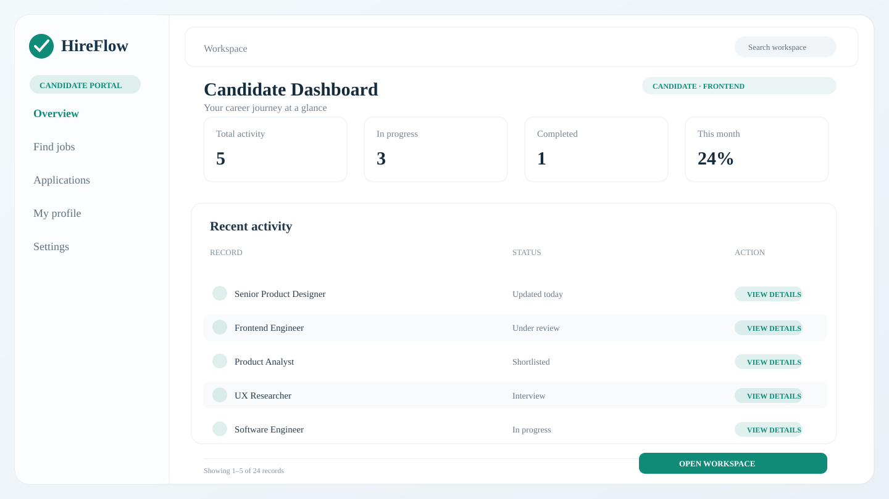
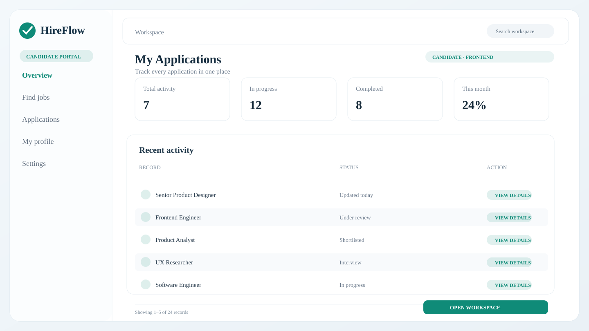
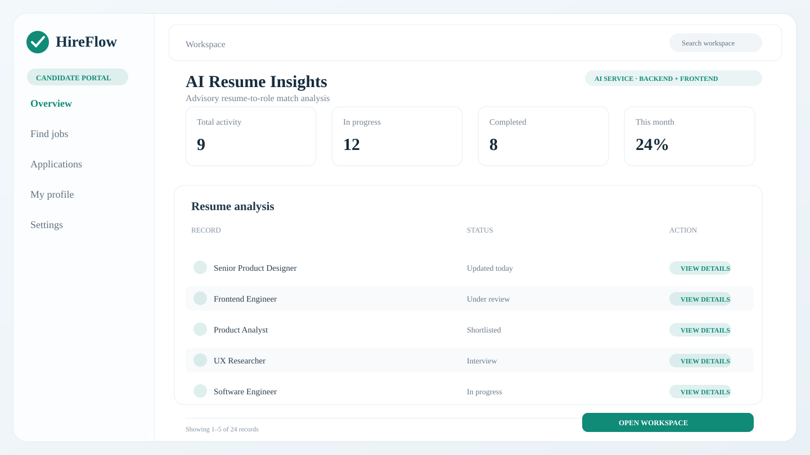
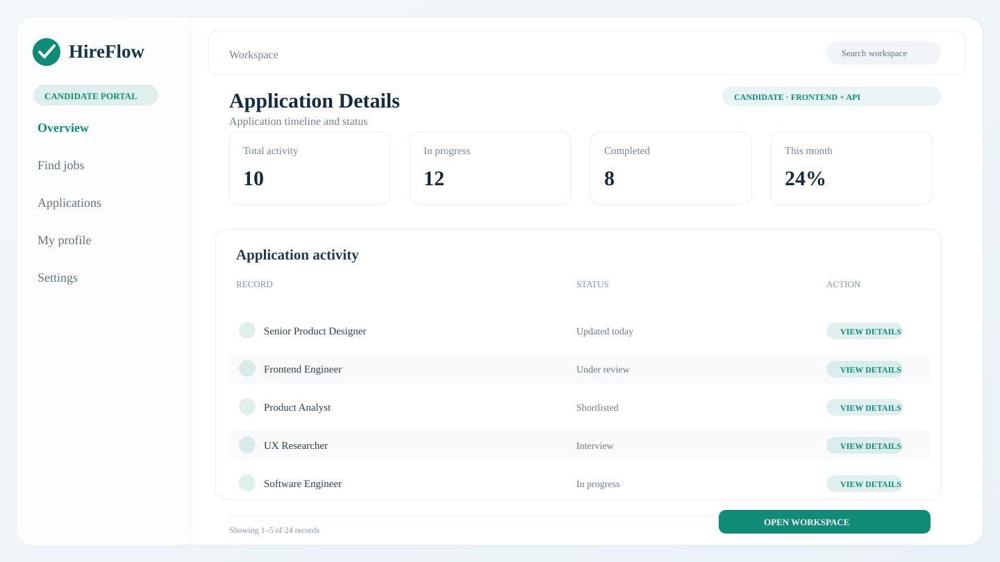
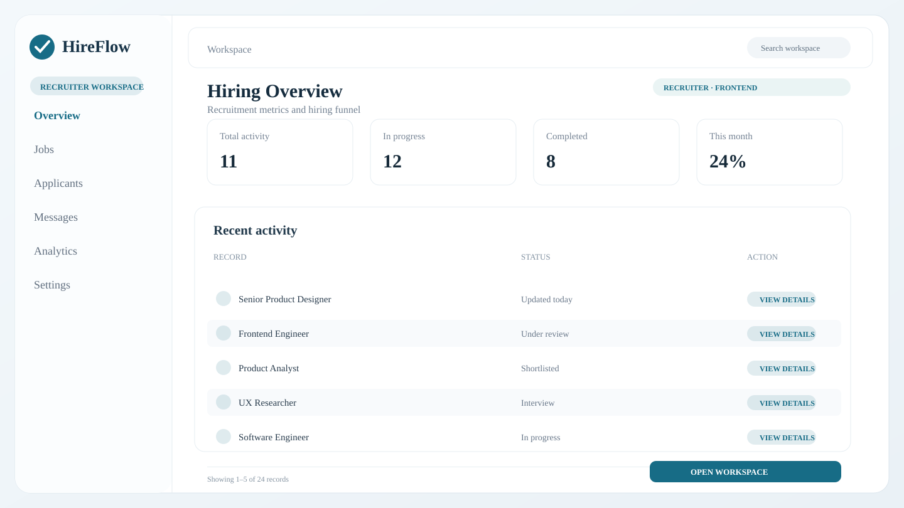
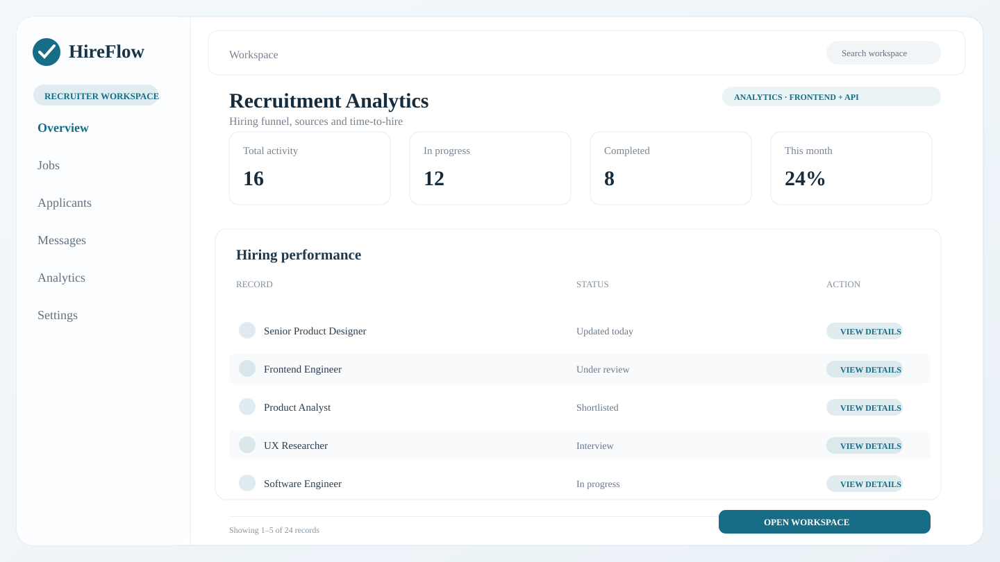

<div align="center">

# HireFlow

**AI-assisted Applicant Tracking System for candidate discovery and recruiter workflows.**

[](https://github.com/matiur25580/ats-recruitment-system/actions/workflows/ci.yml)
[](https://react.dev/)
[](https://www.typescriptlang.org/)
[](https://nodejs.org/)
[](https://www.mongodb.com/)

[**Live Demo**](https://ats-recruitment-system-nu.vercel.app) · [**Deployment Guide**](DEPLOYMENT.md) · [**Learning & Interview Guide**](docs/PROJECT_LEARNING_GUIDE.md)

</div>

---

## Overview

HireFlow is a full-stack recruitment platform that connects candidate and recruiter workflows in one application.

Candidates can build a professional profile, manage a private PDF resume, explore job openings, submit applications, and track their progress. Recruiters can publish roles, review applicants for their own vacancies, access candidate resumes securely, and manage application statuses.

The platform also includes **AI-assisted resume-to-job analysis** using Google Gemini. Its output is an advisory matching signal—not a hiring decision or a substitute for human review.

> **Project status:** HireFlow is an actively developed portfolio project. Core candidate and recruiter workflows, API integration tests, and browser checks are implemented. External services such as Cloudinary, Gemini, and SMTP require valid configuration and separate production verification. This demo is not a production hiring service; use test data only.

## Features

### Candidate experience
- Candidate registration and sign-in with clear validation and login feedback.
- Password recovery using hashed, single-use tokens that expire after 30 minutes.
- Editable profile with headline, summary, location, contact details, skills, work history, and education.
- Profile completion checklist.
- Private PDF resume upload, replacement, viewing, and deletion.
- Job discovery, application submission, and application status tracking.

### Recruiter experience
- Dashboard with job and application metrics.
- Create and manage job posts, including role details, requirements, location, salary, job type, and experience level.
- Review applicants for recruiter-owned jobs.
- Access resumes through short-lived private download links.
- Move applications through Pending, Reviewed, Accepted, and Rejected.
- Email notifications for new applications and status changes when SMTP is configured.

### AI-assisted resume matching
- Extract text from uploaded PDF resumes.
- Compare resume content with job descriptions and requirements using Gemini.
- Return a validated match score and concise summary.
- Handle unavailable AI configuration or analysis gracefully.

**Responsible use:** AI scores can be incomplete or biased. Recruiters should assess candidates using job-relevant evidence and human review, and must not use an AI score as the sole hiring criterion.

## Technology stack

| Layer | Technologies |
|---|---|
| Frontend | React 19, TypeScript, Vite |
| Styling and UI | Tailwind CSS 3, custom CSS, Lucide React, React Hot Toast |
| Routing and API | React Router, Axios |
| Visualization | Recharts |
| Backend | Node.js 22, Express 5, TypeScript |
| Database | MongoDB, Mongoose |
| Authentication | JWT, bcryptjs |
| Resume storage | Cloudinary private raw resources |
| AI analysis | Google Gemini API, pdf-parse v2 |
| Email | Nodemailer, configurable SMTP |
| CI | GitHub Actions |

## Architecture

```text
React + TypeScript (Vite)
          |
          | Axios + JWT Bearer token
          v
     Express REST API
          |
          +-- Authentication and role middleware
          +-- Controllers and application workflows
          +-- Mongoose / MongoDB
          +-- Cloudinary (private PDF resumes)
          +-- Gemini (optional resume analysis)
          +-- Nodemailer (optional email notifications)
```

### Repository structure

```text
.
├── client/
│   └── src/
│       ├── pages/          # Candidate and recruiter screens
│       ├── services/       # Shared Axios API client
│       ├── components/     # Reusable UI components
│       └── App.tsx         # Routes and route guards
├── server/
│   └── src/
│       ├── config/         # Cloudinary configuration
│       ├── controllers/    # API business logic
│       ├── middlewares/    # Authentication and role checks
│       ├── models/         # Mongoose schemas
│       ├── routes/         # REST API routes
│       └── utils/          # AI, JWT, and email helpers
├── docs/
│   └── PROJECT_LEARNING_GUIDE.md
└── .github/workflows/
    └── ci.yml
```

## Run locally

### Prerequisites
- Node.js 22 or a compatible supported release
- npm
- MongoDB (local or hosted)
- Cloudinary account for private resume storage
- Gemini API key for AI resume analysis
- SMTP credentials for email notifications

Cloudinary, Gemini, and SMTP are optional if you are not testing their respective integrations.

### 1. Clone the repository

```bash
git clone https://github.com/matiur25580/ats-recruitment-system.git
cd ats-recruitment-system
```

### 2. Install backend dependencies

```bash
cd server
npm ci
```

### 3. Configure the backend

Create `server/.env`:

```dotenv
PORT=5000
MONGO_URI=mongodb://127.0.0.1:27017/ats_recruitment
JWT_SECRET=replace_with_a_random_secret_at_least_32_characters_long
CORS_ORIGIN=http://localhost:5173

# Required only for private resume upload and delivery
CLOUDINARY_CLOUD_NAME=
CLOUDINARY_API_KEY=
CLOUDINARY_API_SECRET=

# Optional: AI resume analysis
GEMINI_API_KEY=
GEMINI_MODEL=gemini-3.5-flash-lite

# Optional: email notifications
EMAIL_USER=
EMAIL_PASS=
SMTP_HOST=
SMTP_PORT=587
SMTP_SECURE=false
EMAIL_FROM=
CLIENT_URL=http://localhost:5173
```

Use a strong, unique JWT secret. Keep real credentials out of source control.

### 4. Start the backend

From the `server` directory:

```bash
npm run dev
```

The API listens on port `5000` by default. Verify it at:

```text
http://localhost:5000/health
```

### 5. Install and start the frontend

In a second terminal:

```bash
cd client
npm ci
npm run dev
```

Open the Vite URL shown in the terminal (normally `http://localhost:5173`). During local development, Vite proxies `/api` requests to `http://localhost:5000`.

If the API uses a different origin, create `client/.env`:

```dotenv
VITE_API_URL=https://your-api-domain.example/api
```

When omitted, the frontend uses the relative `/api` base path.

## API overview

All endpoints are mounted under `/api`.

| Method | Endpoint | Access | Purpose |
|---|---|---|---|
| POST | `/auth/register` | Public | Register a candidate |
| POST | `/auth/login` | Public | Sign in |
| POST | `/auth/forgot-password` | Public | Request password reset |
| POST | `/auth/reset-password` | Public | Reset password with one-time token |
| GET | `/jobs` | Public | Browse job records |
| POST | `/jobs` | Recruiter | Create a job |
| POST | `/applications/:jobId` | Candidate | Apply for a job |
| GET | `/applications/my-applications` | Candidate | View own applications |
| GET | `/applications/:jobId` | Recruiter / owner | View applicants for an owned job |
| GET | `/applications/:appId/resume` | Candidate / owning recruiter | Get a short-lived resume URL |
| PUT | `/applications/:appId/status` | Recruiter / owner | Update application status |
| GET / PUT | `/profile` | Candidate | Read or update own profile |
| POST / GET / DELETE | `/profile/resume` | Candidate | Manage own resume |
| GET | `/stats/recruiter` | Recruiter | Read recruiter metrics |
| GET | `/admin/overview` | Admin | Read aggregate platform metrics |
| GET | `/admin/audit-logs` | Admin | Read filtered audit events |

Protected endpoints expect a JWT bearer token:

```http
Authorization: Bearer <your-jwt>
```

## Security and privacy

- Public registration creates a **candidate** account; the server ignores client-supplied role values.
- Passwords are hashed with bcrypt.
- Password-reset tokens are cryptographically random, stored as SHA-256 hashes, single-use, and expire after 30 minutes. Resetting a password increments the session version so previously issued JWTs stop working.
- Protected requests verify JWTs and load the current user from the database.
- Role middleware restricts candidate and recruiter actions.
- Recruiter access to applications and resumes is scoped to jobs owned by that recruiter.
- Resume PDFs are stored as private Cloudinary resources. The API checks ownership before issuing short-lived download links.
- Upload endpoints enforce file-size limits and verify PDF content signatures.
- Configure `CORS_ORIGIN` for the exact production frontend origin(s); store secrets in environment variables or deployment secret stores.

**Account-enumeration note:** The login flow distinguishes an unknown email from an incorrect password. This improves user feedback but can reveal whether an account exists. Production deployments should retain strict authentication rate limits and monitor abuse.

## Testing and quality checks

### Frontend (`client`)

| Command | Purpose |
|---|---|
| `npm run dev` | Start Vite |
| `npm run build` | Build frontend |
| `npm run lint` | Run Oxlint |
| `npm run preview` | Preview production build |
| `npx playwright test` | Run browser tests (install Playwright and Chromium first) |

### Backend (`server`)

| Command | Purpose |
|---|---|
| `npm run dev` | Start TypeScript API |
| `npm run build` | Compile TypeScript |
| `npm start` | Start compiled API |

The CI workflow runs backend validation and MongoDB-backed API integration tests, alongside Playwright browser checks for registration, login, password recovery, and candidate/recruiter dashboards across desktop and mobile viewports.

Cloudinary, SMTP, and Gemini provider calls are not treated as live checks in normal CI. The repository also includes a manual production integration smoke workflow for testing configured external services with real credentials.

## Search, pagination, and auditability

- Job listings support server-side pagination and search, with public filters for job type, experience level, and location.
- Recruiter job lists support status filtering.
- Recruiter applicant lists support pagination, candidate name/email or cover-letter search, and application status filtering.
- Admin audit logs support pagination and optional `action` and `entityType` filters.
- Audit events cover job creation/updates/status changes, application submissions/status changes, and recruiter notes. Safe metadata is recorded—not resume bytes, credentials, or request bodies.
- SMTP supports Gmail or a generic provider. Notification delivery retries once; a failed notification does not roll back a saved application or status change.

## Deployment

See the **[Render + Vercel + MongoDB Atlas deployment guide](DEPLOYMENT.md)** for production topology, build settings, environment variables, Atlas network restrictions, and post-deployment checks.

A Render Blueprint is provided at `render.yaml`; Vercel SPA routing is configured in `client/vercel.json`.

### Manual integration smoke test

The `Production integration smoke test` workflow is manually dispatched. It checks the deployed API and frontend, uploads and downloads a temporary private PDF through Cloudinary, sends the PDF for Gemini analysis, and sends a test email through the configured SMTP provider. The temporary Cloudinary object is deleted after the run.

Before running it, configure the GitHub Actions environment `production-smoke` with these secrets:

- `CLOUDINARY_CLOUD_NAME`
- `CLOUDINARY_API_KEY`
- `CLOUDINARY_API_SECRET`
- `GEMINI_API_KEY`
- `EMAIL_USER`
- `EMAIL_PASS`
- `SMOKE_TEST_EMAIL` (a mailbox you control)

And these environment variables:

- `SMOKE_API_URL` (deployed API origin; the workflow checks `/health`)
- `SMOKE_FRONTEND_URL` (deployed frontend origin)
- Optional: `GEMINI_MODEL`, `SMTP_HOST`, `SMTP_PORT`, `SMTP_SECURE`, `EMAIL_FROM`

A successful SMTP handoff does not prove inbox placement. Check the destination inbox and provider delivery logs.

## Production-readiness checklist

Before treating a deployment as production-ready:

1. Run the integration smoke workflow with real Cloudinary, SMTP, and Gemini credentials; inspect the received email and provider logs.
2. Verify HTTPS, exact CORS origins, frontend API URL, secret configuration, and database connectivity.
3. Load-test production-like infrastructure and validate MongoDB backup and restore.
4. Define monitoring, incident response, privacy retention, and applicable compliance policies.
5. Consider email verification, account lifecycle controls, and optional MFA.

A passing CI run demonstrates that the checked-in code builds and the automated tests pass. A successful smoke run verifies only the external requests it exercises; neither is a certification of legal or compliance readiness.

## Learning and interview preparation

The **[ATS Project Learning & Interview Guide](docs/PROJECT_LEARNING_GUIDE.md)** explains the architecture, request lifecycle, data relationships, authentication, authorization, resume storage, AI analysis, and an interview-ready project summary.

Suggested study order:
1. Frontend entry point and routes.
2. Shared Axios client and JWT flow.
3. Express bootstrap and API routes.
4. Authentication and role middleware.
5. Mongoose models and relationships.
6. Controllers and candidate/recruiter workflows.
7. Cloudinary, Gemini, and email integrations.

## Product dashboard gallery

The following 12 laptop-format screens are **illustrative interface concepts**, not captured production screenshots. They represent documented candidate and recruiter workflows.

<details>
<summary><strong>Candidate workspace</strong> — 6 screens</summary>

**01 · Candidate dashboard**



**02 · Explore jobs**


**03 · My applications**



**04 · Candidate profile**


**05 · AI resume insights**



**06 · Application details**



</details>

<details>
<summary><strong>Recruiter workspace</strong> — 6 screens</summary>

**07 · Hiring overview**



**08 · Job management**


**09 · Applicant pipeline**


**10 · Candidate review**


**11 · Application review**


**12 · Recruitment analytics**



</details>

## Contribution workflow

The README documents `upgrade/ats-complete-modern` as the active development branch for the current upgrade. Keep feature work on a dedicated branch rather than pushing directly to `main`.

Before opening a pull request:
1. Run frontend lint and production build.
2. Run the backend TypeScript build.
3. Add or update tests for changed behavior.
4. Review authorization and ownership checks for protected API routes.
5. Ensure no secrets or personal resume data are committed.

## License

No license file is currently included. Contact the repository owner before redistributing or reusing this project.

---

## Author

**Matiur Rahaman** · Full-Stack Developer

- GitHub: [@matiur25580](https://github.com/matiur25580)
- Email: [rahamanmatiur397@gmail.com](mailto:rahamanmatiur397@gmail.com)

Built as a solo project with React, TypeScript, Node.js, Express, MongoDB, JWT authentication, Cloudinary, and Gemini AI.
